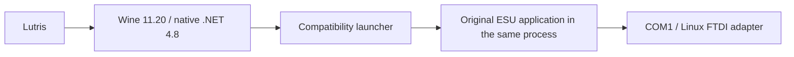

# ESU LokProgrammer through Lutris/Wine

**A decoder read has been demonstrated on Arch Linux.** This repository contains the C# compatibility launcher, pinned build inputs, setup commands, and investigation notes needed to repeat the experiment. It is an independent workaround, not an ESU-supported Linux release.

The original ESU application runs inside the launcher's .NET process. The launcher applies two runtime workarounds: one for WMI COM interop, another for serial reads. It leaves the original `LokProgrammer.exe` on disk unchanged.



## What was tested

| Component or operation | Observed result |
| --- | --- |
| Arch Linux, Lutris 0.5.22 | Used for the successful hardware tests |
| LokProgrammer 5.2.18, build B26120 | Main window and decoder reading work |
| Kron4ek **classic amd64** Wine 11.20 | A **win32 prefix** with native .NET Framework 4.8 |
| FTDI FT232R USB-to-serial, `ftdi_sio` | Accessible through a stable `/dev/serial/by-id/` path as COM1 |
| Decoder information/data read | User confirmed completed reads, including a faster read with the final workaround |
| Serial timing | Final trace: 96 completed reads, 11,993 received bytes, about 6.9 seconds; median available-byte wait 17.5 ms |
| UI reliability | Intermittent idle/repaint stalls were reported; resizing sometimes helped; unresolved |
| Sound uploads, decoder writes, firmware updates | **Not validated** |
| Other decoders, distributions, Wine versions | Not validated |

The timing figures describe one serial trace. They are not a controlled comparison with Windows. The decoder model and hardware-unit revision were not recorded. A successful read is evidence that this combination is possible, not a general compatibility guarantee. See [validation](docs/validation.md) for the boundary between hardware observations, build checks, and the fresh-prefix replay.

## Prerequisites

- Arch Linux with Lutris, Python 3.12+, and the runtime dependencies required by the classic 32-bit Wine runner. Configure Arch's multilib packages as needed for your machine.
- `cabextract`, `unzip`, `xz` and a downloader supported by Winetricks (for example `curl`). The Python helper uses Python's HTTPS client for its pinned downloads.
- ESU LokProgrammer 5.2.18 installer, downloaded separately from [ESU](https://www.esu.eu/en/downloads/software/lokprogrammer/). Extract its ZIP first. ESU requires .NET Framework 4.8.
- FTDI adapter, externally powered programmer, and a decoder or locomotive on an isolated programming track for the eventual read test.

This repo does not contain ESU software, sound projects, decoder firmware, Microsoft installers, Wine binaries, personal logs or Wine prefixes. Download dependencies from their upstream sources. Harmony's MIT notice is retained in `licenses/` and in generated build packages.

## Repeat the setup

Clone this repository and run the following from its root. Use your ordinary user account. The scripts never run `sudo`, change groups, kill Wine processes or write decoder data.

The default dedicated prefix is `~/.local/share/lutris/prefixes/esu-lokprogrammer`. Each command supports `--prefix` and `--wine` **before** the subcommand if you need different paths. Do not point initialization at an existing prefix containing applications.

### 1. Inspect the adapter and permissions

```sh
python scripts/lokprogrammer.py inspect
ls -l /dev/serial/by-id/
id
```

Identify the FTDI adapter, not a different USB serial device such as an Arduino. Check its resolved device ownership and current-session read/write access. On the tested Arch system the device belonged to `uucp` and the user was already a member.

If your device is owned by `uucp` and your user is not a member, the usual administrative step is:

```sh
sudo usermod -aG uucp "$USER"
```

Log out and back in so Lutris inherits the new group membership, then inspect again. Do not solve this with a world-writable serial port or by running Wine as root.

### 2. Fetch the pinned runner and create a fresh prefix

```sh
python scripts/lokprogrammer.py fetch-runner
python scripts/lokprogrammer.py init-prefix
python scripts/lokprogrammer.py install-dotnet
```

Use `wine-11.20-amd64`, the classic build that supports `WINEARCH=win32`, rather than the similarly named amd64-wow64 build. The helper verifies the runner archive against the pinned SHA-256 in `dependencies.json`.

`install-dotnet` downloads Winetricks 20260125, verifies its hash, and creates a local copy with the Mono-listing pipeline workaround described in [troubleshooting](docs/troubleshooting.md). It does not modify system/Lutris Winetricks. Native .NET installation can take several minutes. See troubleshooting if it stops at an idle `wineserver -w` restart wait.

### 3. Install the ESU application

Provide the path to the extracted installer you obtained from ESU:

```sh
python scripts/lokprogrammer.py install-esu "/path/to/LokProgrammer_5.2.18_Setup_B26120.exe"
```

This runs the installer's `/S` mode in the dedicated prefix. You can instead run its normal GUI using the same runner and prefix. The Linux FTDI kernel driver handles the serial adapter; a Windows USB driver is not the connection path used in this setup.

### 4. Map the actual FTDI adapter as COM1

Close LokProgrammer and substitute **your** stable device path:

```sh
python scripts/lokprogrammer.py map-port "/dev/serial/by-id/usb-FTDI_YOUR_ADAPTER_ID"
```

This sets both `dosdevices/com1` and `HKLM\Software\Wine\Ports\COM1`. It refuses missing/non-readable devices and an existing different mapping unless you explicitly pass `--replace`. It checks for FTDI vendor `0403` when `udevadm` is available. It never sends data to the device. Wine may already have assigned COM1 to an onboard serial port such as `/dev/ttyS0`; inspect that mapping and use `--replace` deliberately when assigning COM1 to the FTDI adapter.

### 5. Build and install the launcher

```sh
python scripts/lokprogrammer.py build
python scripts/lokprogrammer.py install-helper
python scripts/lokprogrammer.py lutris-config
```

The build downloads **Lib.Harmony 2.3.3** from NuGet with a pinned package SHA-256, then uses the prefix's .NET 4.8 compiler. Output is in ignored `build/`, including `0Harmony.dll`, its license and a checksum manifest. The output name **must remain `LokProgrammerWineCompat.exe`** because the child .NET AppDomain resolves the assembly by name.

`install-helper` requires the application to be closed. It copies the helper and Harmony beside the original ESU executable and backs up any previous helper files in the prefix. It only creates the example application `.config` when no existing one is present. The accessibility switch in that config was retained during the original investigation; its independent necessity was not established.

### 6. Add the installed application to Lutris

Use **Add game → Add locally installed game**. The generated `build/lutris-game.yml` is a settings reference, **not** a Lutris installer to import.

| Field | Value |
| --- | --- |
| Name | ESU LokProgrammer (Wine) |
| Runner | Wine |
| Executable | The installed `LokProgrammerWineCompat.exe` beside `LokProgrammer.exe` |
| Wine prefix | The dedicated prefix above |
| Working directory | The directory containing both executables |
| Wine version | `wine-11.20-amd64` |
| Prefix architecture | 32-bit |
| Lutris runtime | Disabled |
| DXVK, VKD3D, DXVK NVAPI, esync, fsync | Disabled in the tested setup |

Restart Lutris if the manually installed runner is not listed. Select **COM1** in LokProgrammer. Command queuing was disabled during the successful tests; that was retained from investigation, and its independent necessity has not been established.

### 7. Verify before considering writes

First launch the application and test programmer detection. Power the programmer externally; seeing the FTDI adapter in Linux only proves USB detection. Then connect a decoder or locomotive on an isolated programming track disconnected from any layout command station, and use **Read decoder information/data**.

Keep this initial validation to detection and reading. Sound uploads and firmware updates have not been validated here. ESU may update decoder firmware as part of writing sound/data; see its [product description](https://www.esu.eu/en/products/lokprogrammer). If an update is already underway, do not disconnect its power or USB connection.

With the application closed, `LokProgrammerWineCompat.exe --self-test` checks real WMI queries, opens COM1 at 921600 baud with RTS handshake, checks a zero-length read and performs a 200 ms read **without transmitting commands**. Incoming unexpected data makes that check different from the intended no-data timeout test. `--check-wmi` exercises loading the helper in a child AppDomain and running WMI without opening a serial port. `--version` prints the repository helper version.

## Project files and Downloads

ESU projects do not need to be copied into the application's installation directory. Optionally expose your Linux Downloads as Wine D:

```sh
python scripts/lokprogrammer.py map-downloads
```

Then enter `D:\` in LokProgrammer's File → Open dialog. A normal Wine prefix also exposes the filesystem through Z:, for example `Z:\home\YOUR_USER\Downloads`. These mappings do not transfer a project onto a decoder. Opening a project and writing it to hardware are separate actions.

## How it works and how to undo it

Read [architecture](docs/architecture.md), [troubleshooting and rollback](docs/troubleshooting.md), and the source in `src/`. These hooks use private .NET implementation fields and are tied to the tested runtime. Other applications run as separate processes without these hooks. The original ESU executable and system Wine installation are not patched.

To undo the launcher selection, point Lutris back at the original `LokProgrammer.exe`; the previous WMI failure can then return. To roll back only a helper revision, close the application after saving and finishing device operations, then restore the previous helper and dependency from the prefix's `lokprogrammer-compat-backups/` directory.

## Development and sharing results

```sh
python -m unittest discover -s tests -v
```

`build.ps1` builds the same sources on Windows with .NET Framework's compiler. CI checks the Python setup logic, builds the launcher on Windows and runs the WMI/loader check; it does not claim access to a LokProgrammer or decoder. See [CONTRIBUTING](CONTRIBUTING.md) for useful compatibility reports. Project code is MIT licensed; upstream components retain their own licenses, listed in [THIRD_PARTY](THIRD_PARTY.md).
